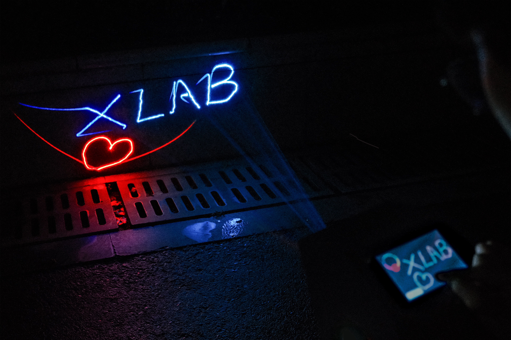
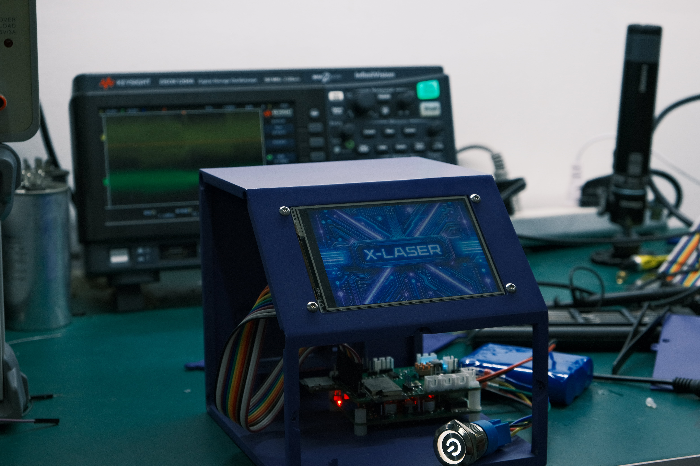
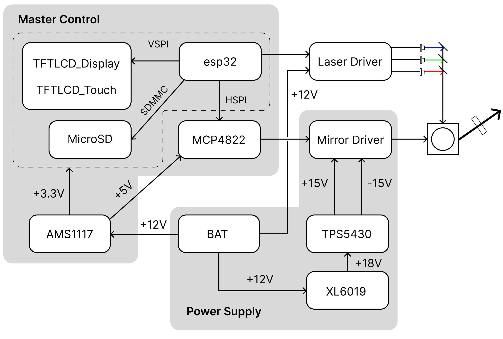
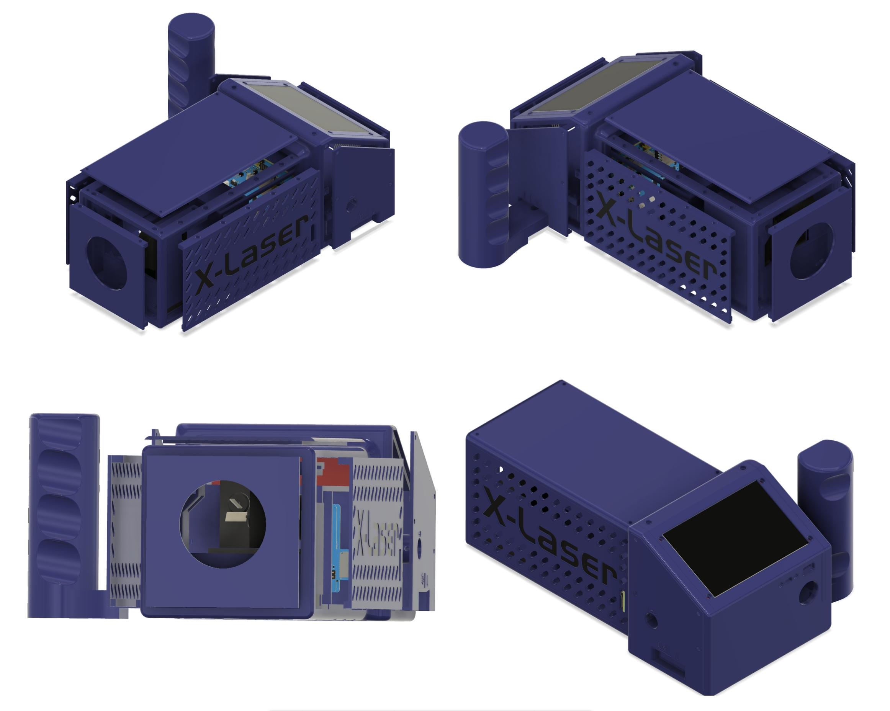
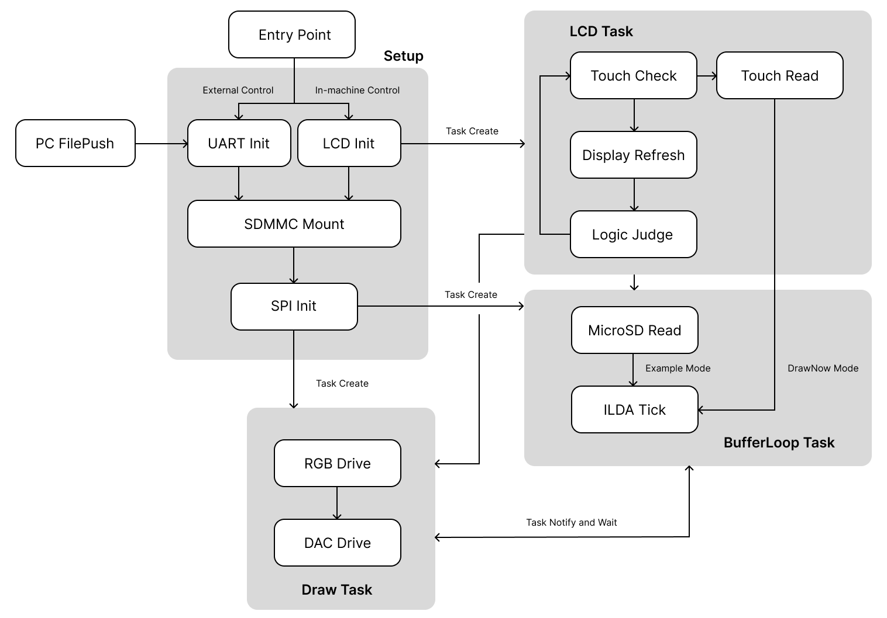
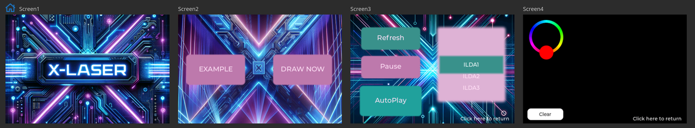
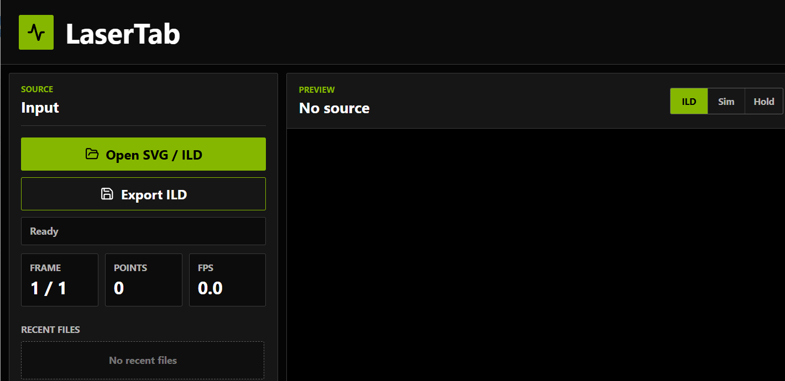

# X-Laser 矢量激光投影仪

> 
> X-Laser 是我们做的一款小型的矢量激光投影仪，旨在为用户带来全新的激光体验——轻松创建个性化投影，应用于各类场景中。X-Laser 以激光搭建虚拟与现实的桥梁，为影像呈现、艺术创造、行车导航等应用提供创意新思路。

本项目基于激光振镜技术，通过振镜的偏移改变激光发射方向，利用人眼视觉暂留效应投影矢量动画。用户可以将激光动画（以 ild 为后缀的文件）存储到 MicroSD 卡中，启动后选择“Example”进行播放；也可选择“Draw Now”，在 LCD 屏幕上绘制自己想要的激光动画进行投影！

本仓库开源的资料包括

- 两块核心板的电路设计原理图和 PCB
- MCU 固件源码及屏幕 UI 工程源文件
- 上位机发布包、示例文件与使用说明
- 外壳设计结构工程源文件

GitHub 仓库链接 [https://github.com/zrrraa/X-Laser](https://github.com/zrrraa/X-Laser)

嘉立创工程链接 [https://oshwhub.com/small-horn-projection-team/x-laser](https://oshwhub.com/small-horn-projection-team/x-laser)

B 站演示视频

[【X-Laser】矢量激光投影仪！磕磕绊绊四个月终于收工！](https://www.bilibili.com/video/BV12m411z7Wr/?spm_id_from=333.1387.favlist.content.click&vd_source=1d0c07486a3bd3b0adb8ac548bf6453e)

[【X-Laser V2】我们对一年前做的激光投影仪进行了全面更新……](https://www.bilibili.com/video/BV1VbKRzCEdx/?spm_id_from=333.1387.homepage.video_card.click&vd_source=1d0c07486a3bd3b0adb8ac548bf6453e)

# 0. 更新日志

2024.04.09

* 第一版开源

2025.06.20

* 优化了 Draw Now 模式下激光“拖尾”的问题，现在离散地线条均可清晰地分开
* 新增上位机控制，可在 PC 端实时调试投影。上位机支持 SVG 转 ILDA、ILDA 预览功能！

2026.03.13

- 优化了上位机的 blank transition，激光动画生成的质量更高了

2026.05.13

- 上位机更新为 LaserTab 0.1.0，支持 SVG/ILD 打开、SVG 转 ILDA、ILD 预览、物理投影仿真和 ILDA 导出。

# 1. 项目说明

## 1.1 项目文件架构

### 1.1.1 Hardware

文件夹内是 X-Laser 的核心电路板原理图和 PCB，提供的是立创 EDA 专业版格式的源文件以及 Gerber 格式的光绘文件。

一共两块板子：

- 主控板 (Master Control)：X-Laser 的核心控制板 PCB，主控为 ESP32，外围电路集成了 DAC、MicroSD、TFTLCD 的驱动，其中 TFTLCD 通过杜邦线和主控板相连。振镜电机驱动板和激光驱动板通过 XH 线与主控板相连。
- 电源板 (Power Supply)：用于处理 +12V、+18V、+15V、-15V 的电平关系转换。电源板和主控板通过排针排母和铜柱连接固定，排针排母为主控板提供 +15V 和 -15V，作为差分电路的运放电源。

### 1.1.2 Firmware

Firmware 中提供了主控板的固件工程和屏幕 UI 工程。源码主要内容如下：

- ESP-IDF FreeRTOS 下的多任务循环，包含了三个任务：从 SD 卡到 RAM 的读取与缓存，SPI 驱动 DAC 将 RAM 中的数据输出，TFTLCD 的 UI 交互与控制。主要包含在 `esp32/src/CoreLoop.cpp` 文件中。
- TFTLCD 的 UI 文件和 SquareLine Studio 工程源文件，在 LVGL 和 TFT_eSPI 库上实现了用户对激光动画的选择播放和手绘。SquareLine Studio 工程在 UI 文件夹中，lvgl 事件和 TFTLCD 驱动在 `esp32/lib` 中和 `esp32/src/MyTFTLCD.cpp` 文件中。
- SDMMC 的驱动和 HSPI、VSPI 的驱动，主要包含在 `esp32/src/SPIRenderer.cpp` 和 `esp32/src/SDCard.cpp` 中。
- ILDA 文件相关的函数，主要包含在 `esp32/src/ILDAFile.cpp` 中。
  代码是在 VS Code 的 PlatformIO 下架构的，用 PlatformIO 打开工程，通过 CH340 连接 TX、RX 引脚即可烧录固件。

### 1.1.3 Software

Software 中提供当前推荐使用的 LaserTab 上位机发布说明、示例 SVG 和使用说明。正式软件包通过 GitHub Releases 发布。

* [Releases](https://github.com/zrrraa/X-Laser/releases) 中提供 LaserTab 的 Windows 安装包、便携版程序和 ESP32 固件包。
* `releases/LaserTab/` 中保存各版本的发布说明。
* `emaple_svg/` 中包含可用于体验 SVG 转 ILDA 的示例 SVG 文件。

### 1.1.4 3D Model

文件夹里是 X-Laser 结构设计的 Fusion 源工程文件和可直接用于 3D 打印的模型文件。

### 1.1.5 Docs

包含了相关的参考文档，包括 ILDA 文件的文档、可播放的激光动画文件、重要芯片的 Datasheet，以及本项目用到的外设的相关参数和物料清单等。

# 2. 硬件架构说明

## 关于结构设计

X-Laser 的结构设计采用主框架加可拆卸面板的形式，内部为激光模组、振镜、电源板、主控板和屏幕预留安装空间，外部通过带散热孔和 Logo 镂空的面板形成保护外壳。

这张外观图展示了新版结构的整体装配关系：前端为激光出光口，顶部斜面安装 TFTLCD，侧面开孔面板兼顾散热和内部检修，后侧圆柱结构用于握持或附加安装。

Logo 面包含了电源总开关的固定螺纹、SD 卡的镂空槽、拨动开关的安装槽以及串口模块的镂空槽，固定激光振镜驱动板的一面采用连续开槽设计，美化观感以及方便散热。主体框架的斜面上设计了固定 TFTLCD 屏幕的光孔。两块 PCB 通过铜柱和排针排母上下固定，竖直安装在背面。若有装配支架的需求，可以购买带磁吸环的支架置于底部。

## 关于固件源码

本项目的固件基于 esp-arduino 开发，调用了 ESP-IDF FreeRTOS 的 API，很好地同步了多个外设的运作。程序主要流程见下图。

X-Laser 选用 ESP32 作为主控 MCU，通过 HSPI 驱动 DAC 芯片控制振镜电机；RGB 激光二极管模组由 MCU 控制信号决定七种颜色；人机交互接口选用了 TFTLCD 触摸屏，通过 VSPI 驱动；MicroSD 卡采用 SDMMC 进行通信。

对于多外设的管理问题，三个外设（将 LCD 的 display 和 touch 视为一个）都需要持续运行，在初版设计中，采用两路 SPI 控制所有外设，效果不好，SPI 分时复用时空闲的任务易跑飞，RTOS 的阻塞和通知也无法完美地稳定它们，且投影的帧率会受限，最终选择用 SDMMC 读取 MicroSD 卡。

关于缓存和投影两个任务之间的通知和阻塞，思路是所有上层逻辑只控制缓存，不直接对投影生效；缓存满了即自阻塞；投影执行后通知缓存，投影依赖于缓存，不能让投影空帧的情况发生。

在需要清空 RAM 中激光动画数据时，比如 DrawNow 模式的 Clear，思路类似栈操作，只将指针调回内存起始点，诸如总帧数之类的变量清零，不主动清空动画数据。

LCD 的 UI 基于 SquareLine Studio 设计。

SquareLine 导出的 LVGL 库里不能调用自己写的函数，为了使用 `lv_events.c` 里的按键回调，目前采用的办法是在此文件中的定义一个变量作为按键状态，在自己写的头文件中声明此变量为外部变量，再在 LCD Task 中对这个变量做判断，即可在自己的函数文件中写按键事件。

## 关于电源管理和振镜驱动

X-Laser 采用 12V 锂电池供电，接口为 XH 封装，注意正负方向。可装配带有 DC 口充电的锂电池，将充电口用胶水固定在侧面的圆孔中。12V 在电源板上升压为 18V，再降压成正负 15V（若只升压到 +15V 无法降压为 -15V）。12V 给激光驱动板供电，同时也通过排针排母连到主控板，在主控板上降压成 5V 和 3.3V 给 MCU 及板上外设供电；正负 15V 通过排针排母连到主控板，给控制振镜电机驱动板的差分电路供电。

MCU 根据投影点的位置计算比例映射关系，通过 DAC 输出 +1.024V\~+3.072V，经偏置放大电路后转为 -2.048V\~+2.048V，输入到振镜驱动板，驱动振镜的偏转。

## 关于大电流驱动问题

对于手绘模式，LCD 会读取触摸点和此时的 Colorwheel 参数，存入结构体变量中，并通知 Draw Task 循环已存入的触摸点投影。当已存入的点数很少时，振镜电流会很大，导致 12V 升 18V 电路中电感焊锡熔化炸飞。在最终版的电路中采用了 330uH 的大电感，并且在固件源码中对点数做了判断，在点数少时降低了振镜频率。

类似的，电流过大会导致主控板上的自锁开关烧毁。由于这个自锁开关仅在测试时用到，后续焊接时换成了排针和跳线帽常闭连接，PCB 和原理图上没作修改。

在最初版的电路中，我们尝试直接用 MOS 管驱动激光二极管，导致激光二极管工作在不正常的状态，烧坏了很多个；同时 MOS 管因承受不了大电流也频繁烧坏，后改为采用原配激光驱动板进行驱动，MOS 管仅作开关电路。

## 关于编译，烧录和启动

芯片至少需要有 2MB 的 Flash，在 PlatformIO 中编译时需要加入分区表，可参考官方分区表 example。本项目的分区表在 `Firmware/esp32/huge_app.csv` 中。MicroSD 的 DAT0 引脚连到了 ESP32 的 IO2，会强制拉高，在烧写固件时需要给 H31 排针插上跳线帽，将此引脚拉低，让 ESP32 进入下载模式。在 X-Laser 中我们选用了 N8R8 的模组芯片，实际上不需要这么多 RAM，因为采用了动态读写。

ESP32 的上电自启动需要 BOOT 拉高，虽然 BOOT 默认上拉，但在最后一版设计中实际测试时发现如果没有手动上拉程序不会自启动，因此在最后一版电路中用 1K 的电阻手动上拉。
在 MicroSD 卡中新建一个文件夹命名为 ILDA，放入激光动画文件，启动后可在屏幕的 roller 中看到读取到的激光动画文件。动画文件名称长度要短于 15 个，否则会显示不全，也无法正常播放。

## 关于 DrawNow 模式

触摸屏的刷新和读取触摸点有频率限制，因此“缓慢”地绘制效果更好。绘制激光动画时，激光二极管需要在两条连续的曲线之间关闭，等待振镜偏移后再开启，否则会让整个图案封闭，因此需要加入 blank transition。

## 关于 PC FilePush

用户可通过拨动侧面的开关来选择上电后的控制模式，分为 PC 控制和触摸屏控制。拨动开关控制引脚为 IO35，可在第一版的基础上通过飞线连接。PC 控制下，上位机与 X-Laser 之间通过串口通信。我们在侧面板上加装了 TTL 转 Type-C 母口的模块，可通过 USB 转 Type-C 数据线连接 X-Laser 与 PC 端上位机。

本质上播放 SD 卡中的 ILDA 文件，只不过通过上位机实时将文件从 PC 发送到 X-Laser 的 SD 卡内了。需要在 SD 卡的根目录下新建文件夹“FilePush”，用于储存上位机发送的文件。

# 3. 软件使用说明

当前推荐从 [GitHub Releases](https://github.com/zrrraa/X-Laser/releases) 下载最新版本的 LaserTab。普通用户建议下载 Windows 安装包，也可以下载便携版程序直接运行。LaserTab 用于把 SVG 或 ILD 文件转换、预览和导出为适合 X-Laser 播放的 ILDA 文件。

主要功能包括：

* 打开 SVG/ILD 文件，并维护最近打开文件列表。
* 对 SVG 进行采样、路径规划和 blank transition 处理，导出 ILDA 文件。
* 直接预览 ILD 命令轨迹，也可以用内置物理仿真器预览接近真实投影的效果。
* 调节输出质量、XY 平移缩放、振镜带宽、激光功率、光斑半径等参数，在流畅度和精度之间做取舍。
* 支持多帧 ILD 动画预览。
* 安装包版本会在启动时检查签名更新清单，发现新版本时可在软件内下载安装；便携版可以直接从 Releases 下载新版替换。

LaserTab 0.1.0 的图形化界面如下图。

# 4. 致谢

YouTube 博主 atomic14 的项目为我们学习 ILDA 文件的结构解析以及整体代码架构带来了很大的帮助。
[https://github.com/atomic14/esp32-laser-show/tree/main](https://github.com/atomic14/esp32-laser-show/tree/main)

up 主酷睿比比的项目 bbLaser 中优秀的结构设计和代码思路为 X-Laser 的设计提供了很大的帮助，非常感谢。
[https://github.com/RealCorebb/bbLaser](https://github.com/RealCorebb/bbLaser)

kvdz 的正负电源文章写得非常详细，在我们设计电源板中的正负电源电路时提供了很大的帮助。
[https://blog.csdn.net/kvdz_taobao_com/article/details/103510539](https://blog.csdn.net/kvdz_taobao_com/article/details/103510539)

Pieski 在电路调试上给予了我们很多指导意见，特此致谢。

稚晖君老师的项目开源架构非常完善，具有参考价值，为我们第一次尝试开源提供了很好的学习途径。
[https://github.com/peng-zhihui/HelloWord-Keyboard/tree/main](https://github.com/peng-zhihui/HelloWord-Keyboard/tree/main)

感谢浙江大学启真交叉学科创新创业实验室提供的项目启动资金。
